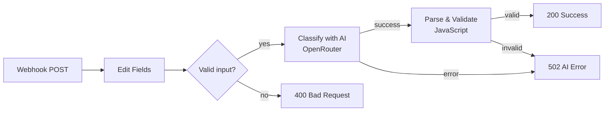
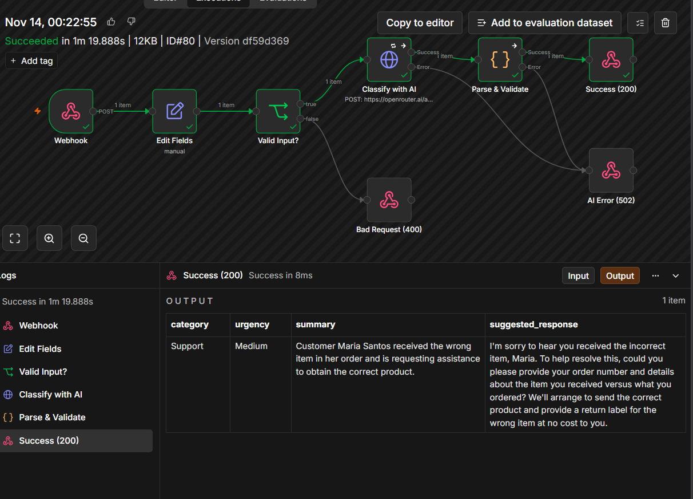
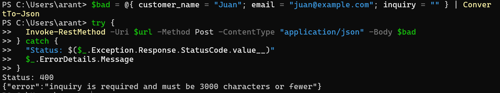
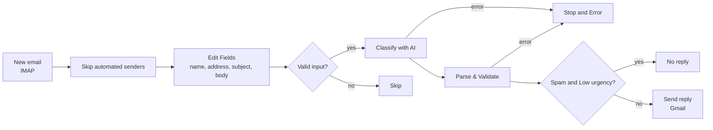

# AI Customer Inquiry Classifier (n8n)

Two n8n workflows that read customer messages, classify them with an LLM, and either return a structured result through an API or answer the email automatically. Spam never gets a reply.


## The problem

Small businesses get the same kinds of messages every day: order questions, complaints, support requests and spam. Someone has to read each one, decide how urgent it is, and write a reply. This project automates the sorting step and drafts the first reply.

## What's inside

| Workflow | Trigger | What it does |
| --- | --- | --- |
| [`Inquiry_Classifier_API.json`](workflows/Inquiry_Classifier_API.json) | Webhook (POST) | Accepts a customer message as JSON and returns its category, urgency, a summary and a suggested reply |
| [`Email_Auto_Responder.json`](workflows/Email_Auto_Responder.json) | Email (IMAP) | Reads new emails, classifies them, replies to real customers and leaves spam unanswered |

Each message gets one of these:

- **Category:** Inquiry, Complaint, Support or Spam
- **Urgency:** Low, Medium or High
- **Summary:** one sentence
- **Suggested response:** a polite reply that makes no promises

## Workflow 1: Inquiry Classifier API




### Example

Request:

```http
POST /webhook/customer-inquiry
Content-Type: application/json

{
  "customer_name": "Maria Santos",
  "email": "maria@example.com",
  "inquiry": "I received the wrong item in my order. Can you help me get the correct product?"
}
```

Response (`200 OK`):

```json
{
  "category": "Complaint",
  "urgency": "Medium",
  "summary": "Customer received an incorrect product and requests assistance.",
  "suggested_response": "Hello Maria! We're sorry you received the wrong item. Could you please provide your order number so we can help?"
}
```

| Case | Status | Response |
| --- | --- | --- |
| Valid message | 200 | Classification result |
| Empty inquiry or over 3000 characters | 400 | `{"error": "inquiry is required and must be 3000 characters or fewer"}` |
| AI unavailable or returned invalid output | 502 | `{"error": "AI classification failed. Please try again later."}` |

### Testing from PowerShell

```powershell
$url = "http://localhost:5678/webhook/customer-inquiry"

# Valid request -> 200
$body = @{
  customer_name = "Maria Santos"
  email         = "maria@example.com"
  inquiry       = "I received the wrong item in my order. Can you help me get the correct product?"
} | ConvertTo-Json
Invoke-RestMethod -Uri $url -Method Post -ContentType "application/json" -Body $body

# Empty inquiry -> 400
$bad = @{ customer_name = "Juan"; email = "juan@example.com"; inquiry = "" } | ConvertTo-Json
try {
  Invoke-RestMethod -Uri $url -Method Post -ContentType "application/json" -Body $bad
} catch {
  "Status: $($_.Exception.Response.StatusCode.value__)"
  $_.ErrorDetails.Message
}
```




## Workflow 2: Email Auto-Responder




## Features

- **Input validation:** empty or oversized messages are rejected before they reach the AI, so no requests are wasted.
- **Output validation:** a JavaScript node strips code fences, extracts the JSON even if the model adds extra text, and checks every field against an allowed list.
- **Safe request body:** the body is built with `JSON.stringify`, so quotes and line breaks in a customer's message can't break the API call.
- **Error handling:** retries (3 tries, 5 seconds apart) cover rate limits. Failures return a clear 502 in the API or mark the execution as failed in the email workflow, never failing silently.
- **Spam guard:** spam gets no reply, since replying confirms the address is active. An email counts as spam only when the AI says Spam and Low urgency, so a contradictory result goes down the normal path.
- **Cost control:** no-reply, mailer-daemon and self-sent emails are filtered out before classification, which also prevents reply loops.
- **Batch-safe:** the parsing step runs once per item, so several emails arriving together are all handled.

## Tech stack

- **n8n:** self-hosted in Docker
- **LLM:** [OpenRouter](https://openrouter.ai) chat completions API with a free model (`nvidia/nemotron-3-ultra-550b-a55b:free`)
- **Email:** IMAP trigger and the Gmail node (OAuth2)
- **Testing:** PowerShell (`Invoke-RestMethod`)
- **Language:** JavaScript (n8n Code node and expressions)

## Setup

1. Run n8n (for example with Docker):
   ```bash
   docker run -d --name n8n -p 5678:5678 -v n8n_data:/home/node/.n8n docker.n8n.io/n8nio/n8n
   ```
2. In n8n, import each file from [`workflows/`](workflows) (**⋯ → Import from File**).
3. Create these credentials and select them in the nodes marked `REPLACE_WITH_YOUR_CREDENTIAL`:

   | Credential | Used by | Notes |
   | --- | --- | --- |
   | Header Auth | Classify with AI | Name `Authorization`, value `Bearer <your OpenRouter key>` |
   | IMAP | Email Trigger (IMAP) | For Gmail: `imap.gmail.com`, port 993, SSL, with an App Password |
   | Gmail OAuth2 | Send Reply | Google Cloud OAuth client with the Gmail API enabled |

4. In **Skip Automated Senders**, replace `YOUR_OWN_GMAIL@gmail.com` with the address that sends the replies.
5. Optional: change the model in **Classify with AI** to any OpenRouter model ID ending in `:free`.
6. Publish the workflows. The API is then available at `http://localhost:5678/webhook/customer-inquiry`.

## Limitations

- **Free tier:** OpenRouter free models allow 20 requests per minute and 50 per day for accounts without purchased credits, so this setup suits demos and low volume.
- **Replies go out without review.** For real use, swap the Gmail **Send** operation for **Create Draft** so a person approves each reply.
- **Data privacy:** some free model providers log prompts. Don't send real customer data through a free endpoint.
- **AI can misclassify.** The spam guard reduces the risk, but logging decisions for review is a recommended next step.


## Author

Built by **John Rey Aranton** as part of an n8n automation learning portfolio.
